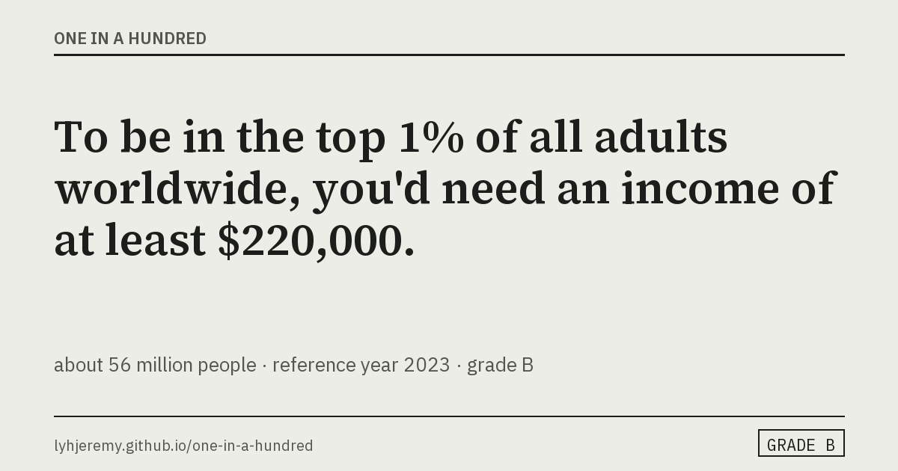

# One in a Hundred

[](https://github.com/lyhjeremy/one-in-a-hundred/actions/workflows/tests.yml)

Claims like "earning $30,000 a year puts you in the global top 1%" are easy to repeat and hard to check. This site shows what it takes to be in the top 1% (or top 10%, or the median) of a group: income, wealth, height, weight, BMI, age, life expectancy, marathon times and a growing set of researched measures.

Result: $30,000 is the 75th percentile of world pre-tax income per adult (WID) and the 94th under the most generous definition; the top 1% starts near $220,000. 950 sourced, graded facts sit behind the site, and the parser that reads typed questions gets 181 of 200 frozen test questions exactly right (90.5%).

[Live site](https://lyhjeremy.github.io/one-in-a-hundred/) · [Overview](https://lyhjeremy.github.io/one-in-a-hundred/overview/) · [Write-up](writeup.md) · [Sources](https://lyhjeremy.github.io/one-in-a-hundred/sources/)

Design and copy follow [these standards](https://github.com/lyhjeremy/lyhjeremy/blob/main/DESIGN_STANDARDS.md).



You pick a measure and narrow the group, or ask in words. Each answer comes back as one sentence, with the whole distribution it came from, a confidence grade and the sources underneath.

The site is plain JavaScript (no framework) on GitHub Pages. Behind it sit a Python data pipeline (pandas, requests, Pillow) with one fetcher per source; an offline research loop on `claude -p` with web search, and a Cloudflare Worker for LLM parsing and live research, which is written and not yet deployed.

## Headline numbers

There are 950 facts across 20 countries and the world, from 72 sources, each with a URL and an access date. 3 facts reach grade A (two independent official sources within 10%), 906 are grade B (one official source, or a percentile derived from a published mean), and 41 are grade D (researched automatically, not yet reviewed). 103 facts carry a time series. The rules parser that reads typed questions scores 90.5% exact-triple accuracy on a frozen 200-question gold set.

The project started with the claim that "earning $30,000 a year puts you in the global top 1%". It is false under every definition on the site, by different margins: $30k is the 75th percentile by WID's pre-tax income per adult (top 1% starts near $220,000), 94th by the World Bank's consumption per person (top 1% near $57,000, the source of the "$60k" version).

## The screen

The left rail has five modes; the answer sits in the middle and the evidence on the right.

| Mode | What it does |
|---|---|
| Explore | One grouped select for the measure; group selects that appear only when they offer a choice; Median, Top 10%, Top 1%. The chain above the sentence shows how the group was narrowed and lets you undo any step. |
| Ask | Type the question. A rules parser in the browser turns it into measure, group and percentile; the LLM parser will take over once the Worker is deployed. |
| Where do I land | Your own number, placed on the curve and kept in a profile across measures (browser storage only). |
| Compare | A second group on the same curve, dashed, with a one-line comparison. |
| Surprise me | A random A or B grade fact, whole populations first. |

The curve under every sentence is the full published distribution (value against share of the group at or below it); money is on a log scale. Where the source has history (WID from 1980, NCD-RisC cohorts from 1989), a second chart shows the chosen threshold over time in constant purchasing-power terms.

## How facts are made

```
fetchers (one per source) -> build_facts.py -> verify.py (grades) -> render_cards.py -> build_site.py
queued or seeded questions -> research_queue.py (claude -p with web search) -> inbox (grade D) -> review.py -> reviewed
```

Each fact is one distribution: a measure, a group, a reference year, a grid of percentile points, and its sources. `verify.py` refuses to build a fact without a source and assigns the grade by fixed rules. Questions the catalog cannot answer go to the research loop, which can define a new measure (`data/metrics_extra.json`) and ships the result flagged as unreviewed until `review.py` promotes it. Live research on demand (`worker/src/research.js`) is written and waits for the Worker to be deployed; until then the site offers "Request this fact", which files a GitHub issue.

## Files

| Path | What |
|---|---|
| `index.html`, `app.js`, `chart.js`, `format.js`, `parser-rules.js` | The site. No framework. |
| `data/metrics.json`, `data/metrics_extra.json` | The measure catalog: hand-written, and defined by the research loop. |
| `data/facts/<family>.json`, `data/index.json` | The facts and the lookup index, generated. |
| `f/<id>/`, `cards/<id>.png` | One static page and one share image per fact, generated. |
| `pipeline/fetch/*.py` | One fetcher per source. Raw downloads are git-ignored. |
| `pipeline/build_facts.py`, `verify.py`, `render_cards.py`, `build_site.py`, `build_catalogue.py` | Build, grade, render. |
| `pipeline/research_queue.py`, `review.py`, `prompts/`, `schemas/`, `seeds/` | The research loop, the review CLI, and the seed list of popular questions. |
| `worker/` | Cloudflare Worker: `/parse`, `/research`, `/request`, `/health`. |
| `eval/` | The frozen gold set, the eval script, the results. |
| `writeup.md`, `overview/` | The story and the reader-facing page. |

## Rebuild

```bash
git clone https://github.com/lyhjeremy/one-in-a-hundred && cd one-in-a-hundred
python3 -m venv .venv && source .venv/bin/activate
pip install -r requirements.txt
# downloads (about 2 GB, git-ignored): URL lists at the top of each pipeline/fetch/*.py
python3 pipeline/build_facts.py && python3 pipeline/render_cards.py && python3 pipeline/build_site.py
python3 pipeline/build_catalogue.py && python3 pipeline/test_format.py && python3 eval/eval_parser.py
python3 pipeline/research_queue.py --from-file pipeline/seeds/popular_questions.jsonl   # needs the claude CLI
python3 pipeline/review.py
```

`build_facts.py` stops with a missing-file error until the raw downloads are in `pipeline/raw/`. The Kaggle marathon set is optional and needs a Kaggle account token. Everything after it runs from the committed `data/facts/`, so without the downloads you can still run `render_cards.py`, `build_site.py`, `build_catalogue.py`, `test_format.py` and `eval/eval_parser.py`. The Worker needs a Cloudflare account.

## Grades

A: two or more independent sources, at least one official, within 10% at every shown percentile. B: one official source, or a derived percentile. C: sources disagree by more than 10%, or a definitional mismatch. D: automated research, unreviewed. Review can lower a grade but never raise one.

## What it cannot show

Almost everything is B, because for a given definition official statistics usually have one producer. Height outside the US is derived from NCD-RisC means under a normal assumption. BMI percentiles are interpolated inside published bands. Marathon facts describe a 2013 research sample that skews to North America and Europe. Researched (grade D) facts can mix definitions until a person reviews them. Sensitive breakdowns appear only where the source publishes them. Full list in `writeup.md`.

[MIT](LICENSE) © 2026 Jeremy Lee
